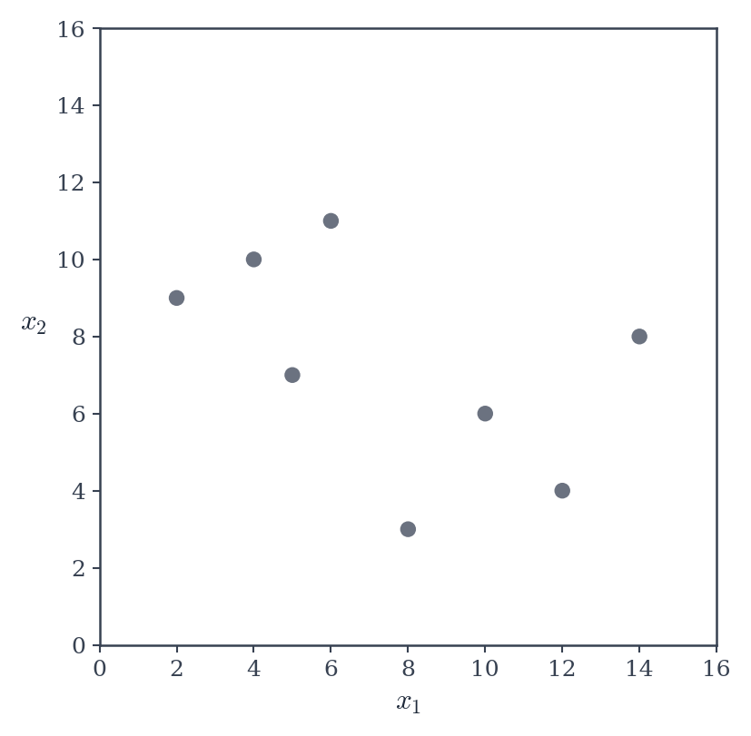
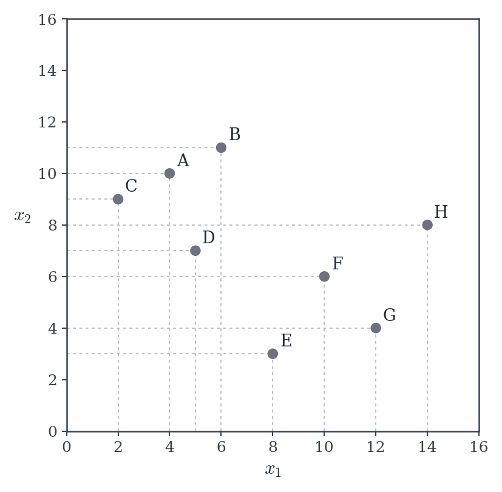
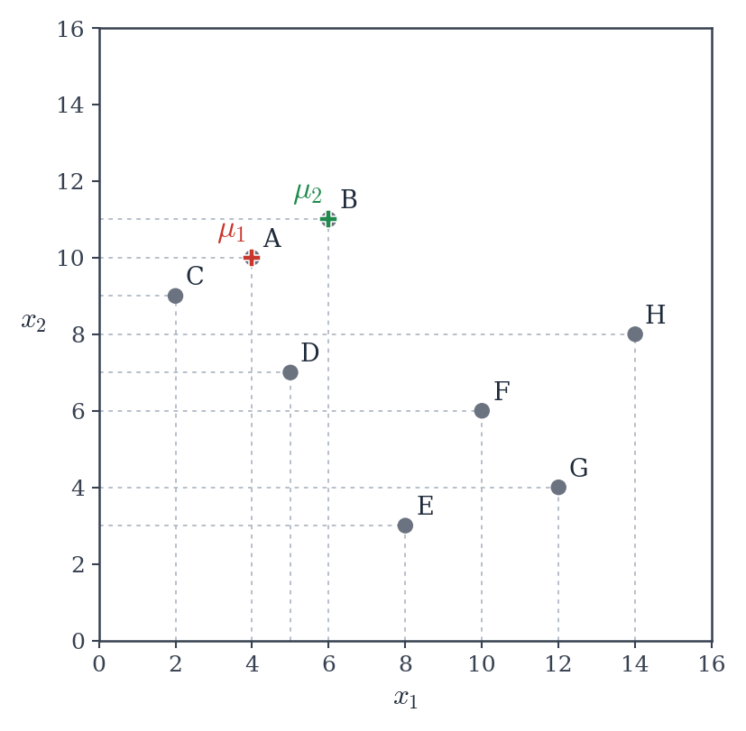
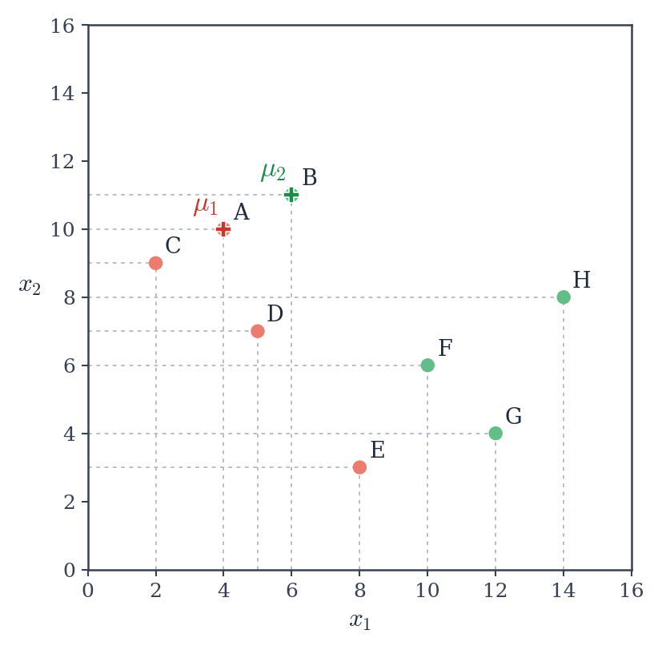
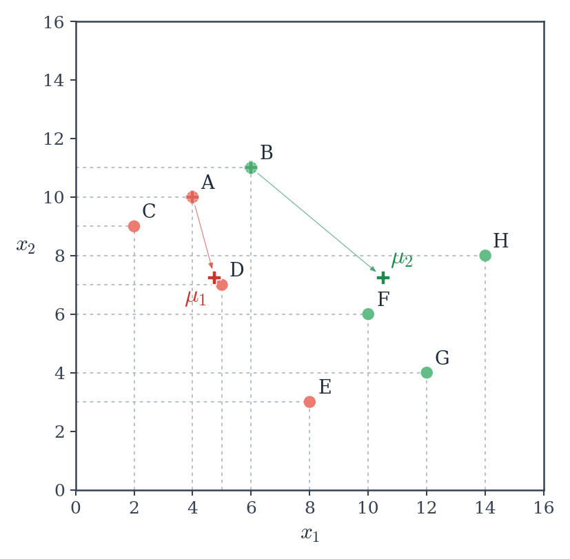
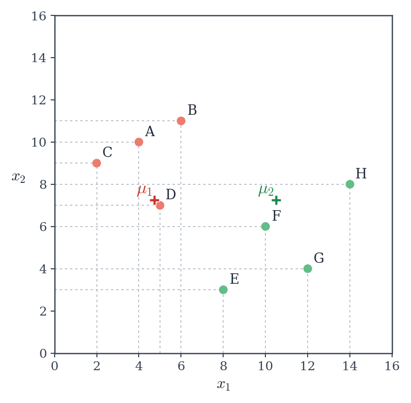
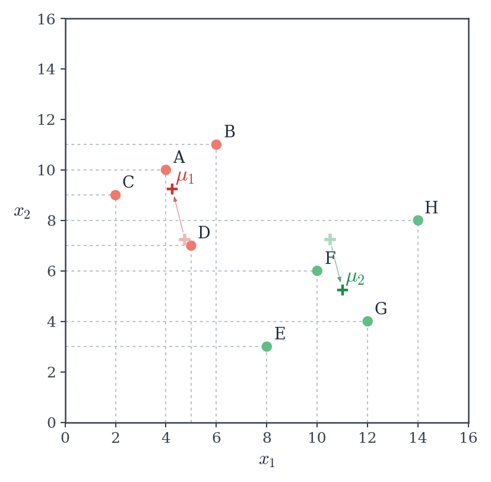
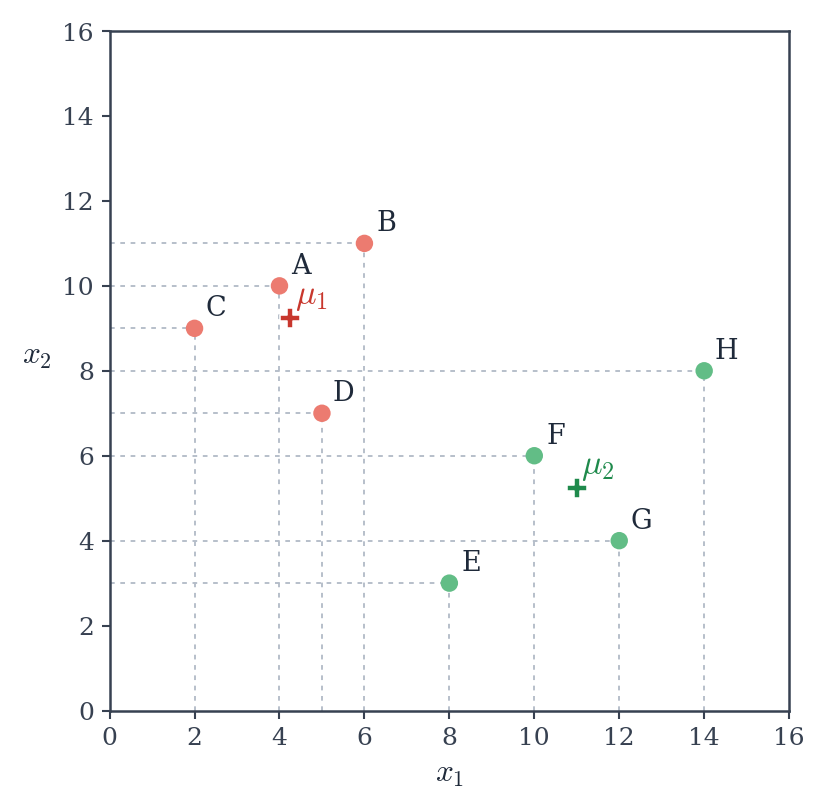

# $k$-Means Step by Step

The simplest clustering algorithm. Featuring: Euclidean distance.


## Key concepts and one rule

Before diving into the procedure, let's define a central notion (pun intended).

````{prf:definition}
:label: centroiddef

A __centroid__ is a position in feature space representing the centre of a cluster. 

In the $k$-Means algorithm, the centroid corresponds to the centre of mass of the points, i.e. its coordinates are the arithmetic means of each feature.

```` 

Other clustering algorithms use other definitions for 'centre':
- $k$-medoids uses an actual data point minimising the total distance to all other points in the cluster
- $k$-medians uses the median of each feature, relying typically on the Manhattan distance (L1 norm) as similarity measure.


Now that we know what a centroid is, we can state the one and only rule behind the clustering algorithm:

```{admonition} $k$-Means Rule
:class: tip

Each point is assigned to the cluster whose centroid is the closest.
```


## An illustrated example

Let's go through a visual and simple case to intuitively present how $k$-Means works.

(kmeanstour)=
<div class="km-carousel" tabindex="0">
  <div class="km-slide"><p class="km-caption"><span class="km-count">1 / 8.</span> Initialization. We need to know the number of clusters beforehand: How many clusters here?</p></div>
  <div class="km-slide"><p class="km-caption"><span class="km-count">2 / 8.</span> We roughly see two clusters. We can pick two random data points and set them as 'centroids' to start the algorithm. Here let's pick A (4, 10) and B (6, 11).</p></div>
  <div class="km-slide"><p class="km-caption"><span class="km-count">3 / 8.</span> Now let's assign each other data point to either <b><i>μ</i><sub>1</sub></b> (red cluster) or <b><i>μ</i><sub>2</sub></b> (green cluster) following the <i>k</i>-Means rule.</p></div>
  <div class="km-slide"><p class="km-caption"><span class="km-count">4 / 8.</span> Points are coloured (assigned): the so-called E-step (expectation) is done. Is it over? No! We need to update our centroids to put them at the centre of mass of their cluster.</p></div>
  <div class="km-slide"><p class="km-caption"><span class="km-count">5 / 8.</span> M-step: let's recompute the centroid positions to minimize the sum of squared distances of each cluster point with respect to their centroid (more on why it is called M-step later). Are we done? No! The rule is not followed: point E is closer to <b><i>μ</i><sub>2</sub></b> than to <b><i>μ</i><sub>1</sub></b>, and point B is closer to <b><i>μ</i><sub>1</sub></b> than to <b><i>μ</i><sub>2</sub></b>. They need to switch clusters.</p></div>
  <div class="km-slide"><p class="km-caption"><span class="km-count">6 / 8.</span> E-step again: we reassign each point to the cluster matching its closest centroid. Point E is now green and B red. Good. Are we done? No! We need to recompute the centroids' positions again.</p></div>
  <div class="km-slide"><p class="km-caption"><span class="km-count">7 / 8.</span> M-step again: the centroids are moved to the centre of mass of their cluster.</p></div>
  <div class="km-slide"><p class="km-caption"><span class="km-count">8 / 8.</span> Are we done? Yes! There is no reassignment of points to do. Nothing has changed. The algorithm has converged.</p></div>
  <button class="km-btn km-prev" aria-label="Previous">&#9664;</button>
  <button class="km-btn km-next" aria-label="Next">&#9654;</button>
  <div class="km-dots"></div>
</div>

```{div} text-center
A step-by-step illustrated example of the $k$-Means algorithm with two clusters ($k = 2$).
```


## The associated cost

We can rephrase this as a minimization problem: the main objective of the $k$-Means algorithm is to minimize the sum of the squared distances between the points and their respective cluster centroid.